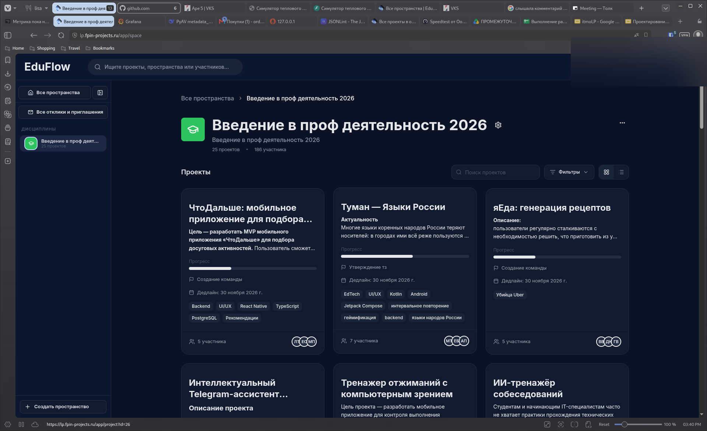
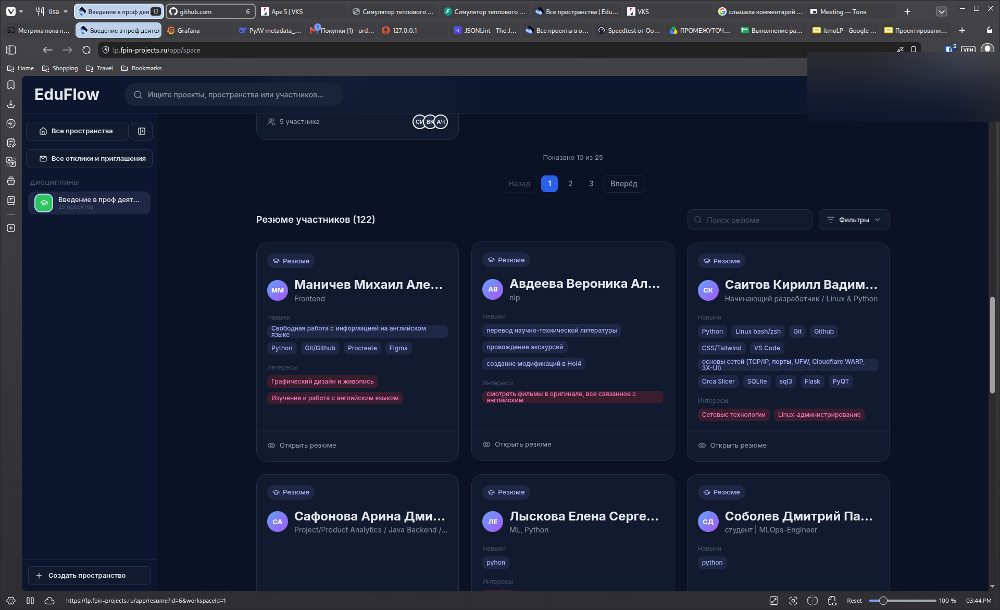
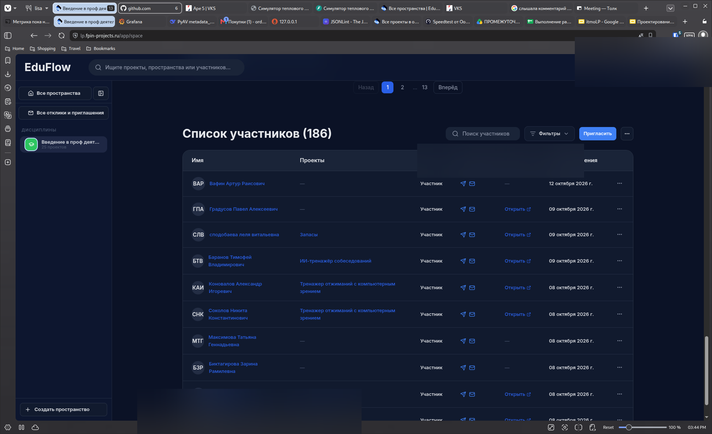
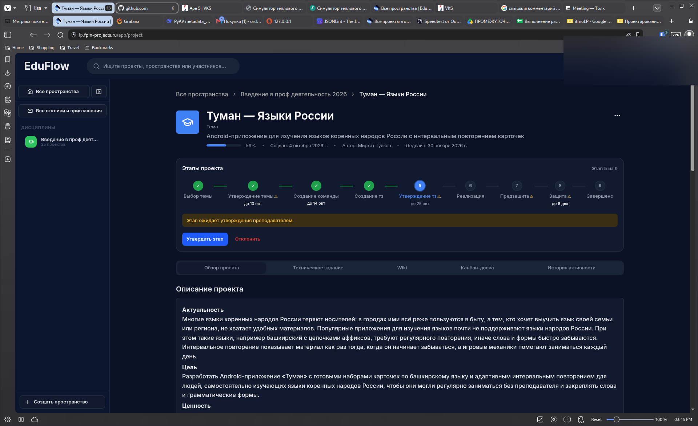
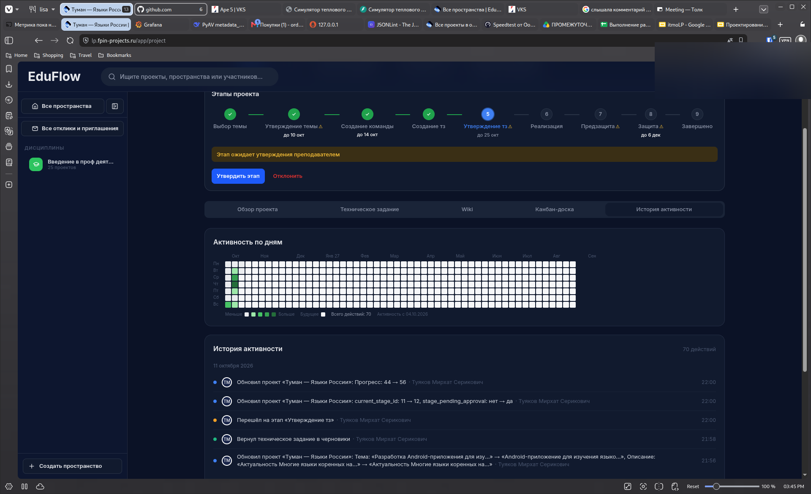
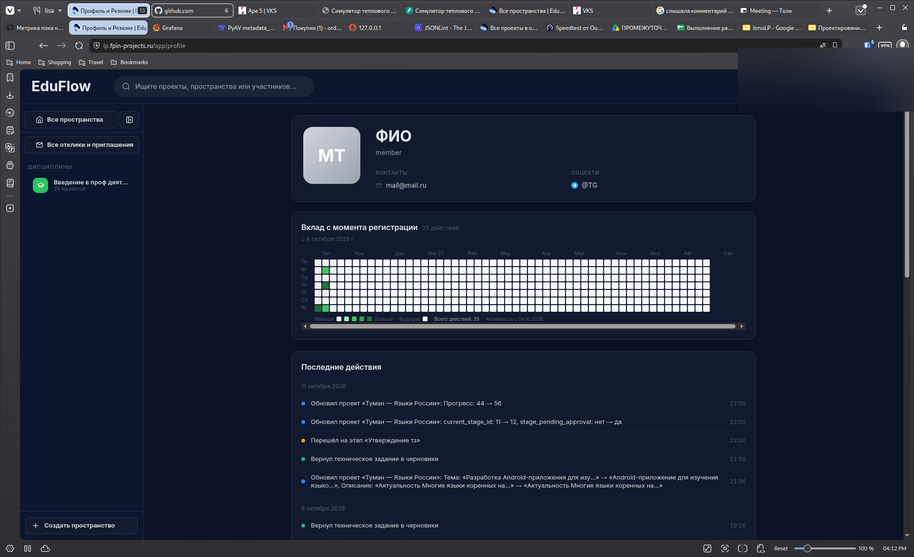

<!-- _paginate: false -->

<!-- _header: "" -->

<!-- _footer: "" -->

<!--
[0:00–0:10] ОТКРЫТИЕ
Привет! Я Антон Афанасьев, основатель EduFlow. Мы делаем платформу, которая собирает проекты, команды и дедлайны в одном месте — для проектного обучения в вузах и для организаторов событий. За три минуты покажу проблему, работающий продукт, бизнес-модель и кейс внедрения в ИТМО.
-->

<i></i><i></i><i></i>

 поиск по проектам

Мой этап ▾
Тег ▾
Участник ▾
Срок ▾
4 проекта

Запланирован

Хакатон «Университет 2026»

Приём заявок, разбор и отбор команд — в одном проекте.

Прогресс

<i style="width:15%"></i>

 18 апр · Подготовка

 4 участника
АМТ+1

В работе

Редизайн сайта

Обновление главной и раздела с курсами, перенос из старой CMS.

Прогресс

<i style="width:55%"></i>

 12 фев · Дизайн

 3 участника
АМД

На проверке

Мобильное приложение

Доска, задачи и уведомления в одном приложении для телефона.

Прогресс

<i style="width:85%"></i>

 28 фев · Разработка

 5 участников
МТД+2

Выполнен

Версия 2.0 API

Обновление контрактов и переход на новую схему авторизации.

Прогресс

<i style="width:100%"></i>

 5 фев · Запуск

 2 участника
ТИ

Хакатон «Университет 2026» · Подготовка
 Фильтры

Канбан22/5

#10016 дн.

Собрать требования к заявке

А

Документы

#10022 дн.

Согласовать ТЗ с комиссией

МД

ТЗ

В работе22/3

#20111 дн.

Форма регистрации команд

ТО

ФронтендДизайн

#20125 дн.

Экран списка проектов

О

Фронтенд

Готово1

#3011

Роли и доступы для жюри

И

Бэкенд

Бесплатно · Данные в России · Отборочный питчинг 2026

Тренажёр для управления учебными проектами

Проекты, команды и дедлайны — в одном месте

Попробовать бесплатно
Войти

Афанасьев Антон · orderkworinaa@gmail.com

<em class="hero-goal">Цель на акселератор — первые платящие клиенты: команды, вузы, организаторы событий</em>

---

<!--
[0:10–0:45] ПРОБЛЕМА
В проектном обучении одновременно десятки людей и команд. Держать в голове, кто в какой команде и на каком этапе, — невозможно. Людей распределяют вручную, в таблицах и чатах: долго, субъективно и не воспроизводится. Всё разбросано — резюме, отклики, приглашения, роли и статусы живут в переписке, единой картины нет ни у кого. И не видно истории: кто что делал и где сорвался срок, по чатам не восстановишь. А цена ошибки растёт с масштабом — это уже не один проект, а весь поток.
-->

## Проблема

<h3>Людей и команд — десятки</h3>
Держать в голове, кто в какой команде и на каком этапе, физически невозможно.

<h3>Распределение вручную</h3>
Подбор по навыкам, интересам и ролям — в таблицах и чатах: долго, субъективно, не воспроизводится.

<h3>Всё разбросано</h3>
Резюме, отклики, приглашения, роли и статусы живут в переписке. Единой картины нет ни у кого.

<h3>Не видно, что происходило</h3>
Кто что делал, где сорвался срок и что пошло не так — по чатам и таблицам не восстановить.

**Цена ошибки растёт с масштабом:** слабый состав, дубли ролей и сорванные сроки — уже во всём потоке, а не в одном проекте.

---

<!--
[0:45–1:07] ЦЕЛЕВАЯ АУДИТОРИЯ
Продукт — для трёх сегментов. Учебные команды и вузы: распределение людей по командам, десятки проектов, оценивание. Организаторы событий: хакатоны и акселераторы, где надо быстро собрать команды, раздать роли жюри и держать дедлайны. Продуктовые команды: доска, этапы и история решений вместо мессенджеров. И это не гипотеза: с 2023 года каждый год 23–27 проектов и 180–220 участников, в 2026 — 26 проектов и 186 участников.
-->

## Целевая аудитория

<h3>Учебные команды и вузы</h3>
Распределение людей по командам, десятки проектов, оценивание.

<h3>Организаторы событий</h3>
Хакатоны и акселераторы: сборка команд, роли жюри, дедлайны.

<h3>Продуктовые команды</h3>
Доска, этапы и история решений вместо мессенджеров.

**Уже четвёртый год работаем в ФПИН ИТМО (с 2023)** — дальше вузы с проектным обучением и организаторы хакатонов.

Участники — столбцы (левая шкала), проекты — линия (правая шкала).

---

<!--
[1:07–1:22] КЕЙС ФПИН ИТМО
Мы не гипотеза: тренажер работает в ФПИН ИТМО с 2023 года, сейчас это 4-й год. В 2026 — 26 проектов и 186 участников. Бакалавры проходят «Введение в профессиональную деятельность», магистранты — «Курсовой проект»: магистрант собирает команду, пишет ТЗ и ведёт проект как руководитель и ментор, а бакалавры реализуют. По опросу студенты получили командную работу, погружение в специальность и реальные инструменты — Docker, FastAPI, Figma, iOS.
-->

## Кейс: тренажер в ФПИН ИТМО с 2023 года

4

года в ФПИН ИТМО (с 2023)

1

дисциплина

26

проектов в 2026

186

участников в 2026

**4-й год внедрения (с 2023)** · Бакалавры — «Введение в профессиональную деятельность» (1 курс) · Магистранты — «Курсовой проект»

<h3>Как это работает</h3>
Магистрант собирает команду, пишет ТЗ и ведёт проект как руководитель и ментор — бакалавры реализуют.

<h3>Что даёт студентам (из опроса)</h3>
Командная работа · погружение в специальность · реальные инструменты (Docker, FastAPI, Figma, iOS, LLM) · интеграция в профессию и профориентация.

С 2026 — новая система: единый список проектов, канбан, ТЗ и вики, роли и отклики в одном пространстве.

---

<!--
[1:22–1:35] ПРОДУКТ
Вот два реальных экрана. Слева — единый список проектов: поиск, фильтры по этапу, тегу, участнику и сроку, карточки со статусом, прогрессом и командой. Справа — канбан проекта: колонки с WIP-лимитами, задачи с приоритетом, дедлайном и исполнителями. Логика простая: пространство → проект с этапами и командой → доска с задачами, ТЗ и вики.
Если спросят: за одним канбаном могут работать несколько команд — это разные проекты в одном пространстве.
-->

## Продукт

<em>Экран 1: единый список проектов</em>

<i></i><i></i><i></i>

 поиск по проектам

Мой этап ▾
Тег ▾
Участник ▾
Срок ▾
4 проекта

Запланирован

Хакатон «Университет 2026»

Приём заявок, разбор и отбор команд — в одном проекте.

Прогресс

<i style="width:15%"></i>

 18 апр · Подготовка

 4 участника
АМТ+1

В работе

Редизайн сайта

Обновление главной и раздела с курсами, перенос из старой CMS.

Прогресс

<i style="width:55%"></i>

 12 фев · Дизайн

 3 участника
АМД

На проверке

Мобильное приложение

Доска, задачи и уведомления в одном приложении для телефона.

Прогресс

<i style="width:85%"></i>

 28 фев · Разработка

 5 участников
МТД+2

Выполнен

Версия 2.0 API

Обновление контрактов и переход на новую схему авторизации.

Прогресс

<i style="width:100%"></i>

 5 фев · Запуск

 2 участника
ТИ

<em>Экран 2: канбан проекта</em>

Хакатон «Университет 2026» · Подготовка
 Фильтры

Канбан22/5

#10016 дн.

Собрать требования к заявке

А

Документы

#10022 дн.

Согласовать ТЗ с комиссией

МД

ТЗ

В работе22/3

#20111 дн.

Форма регистрации команд

ТО

ФронтендДизайн

#20125 дн.

Экран списка проектов

О

Фронтенд

Готово1

#3011

Роли и доступы для жюри

И

Бэкенд

 пространство → проект с этапами и командой → доска с задачами, ТЗ и вики. Отклики, приглашения по ссылке и роли уровня проекта уже в продукте.

---

<!--
[1:35–1:37] ИНТЕРФЕЙС · ЭКРАНЫ 1–2
Единый список проектов с поиском и фильтрами; карточки со статусом, прогрессом и командой.
-->
<!-- _class: shots -->

## Интерфейс 

Экраны 1–2 из 6

<figure></figure>
<figure></figure>

---

<!--
[1:37–1:39] ИНТЕРФЕЙС · ЭКРАНЫ 3–4
Канбан с WIP-лимитами и приоритетами; техзадание с группами требований и согласованием.
-->
<!-- _class: shots -->

## Интерфейс 

Экраны 3–4 из 6

<figure></figure>
<figure></figure>

---

<!--
[1:39–1:40] ИНТЕРФЕЙС · ЭКРАНЫ 5–6
Вики проекта, история активности и уведомления из всех проектов.
-->
<!-- _class: shots -->

## Интерфейс 

Экраны 5–6 из 6

<figure></figure>
<figure></figure>

---

<!--
[1:40–1:55] ВОЗМОЖНОСТИ
Три группы возможностей. Команда: пространства по направлениям, поиск проектов и людей, приглашения по ссылке и отклики, роли и права на уровне проекта. Работа: канбан с перетаскиванием, WIP-лимиты и приоритеты, техзадание с согласованием, вики проекта. Контроль: единый список проектов с фильтрами, уведомления из всех проектов и история активности как в GitHub.
-->

## Возможности

<h3>Команда</h3>
<ul>
<li>Пространства по интересам и направлениям</li>
<li>Поиск проектов и людей в одном поле</li>
<li>Приглашения по ссылке и отклики</li>
<li>Роли и права доступа на уровне проекта</li>
</ul>

<h3>Работа</h3>
<ul>
<li>Канбан с перетаскиванием карточек</li>
<li>WIP-лимиты на колонках, приоритеты, подзадачи</li>
<li>Техзадание с группами требований и согласованием</li>
<li>Вики проекта</li>
</ul>

<h3>Контроль</h3>
<ul>
<li>Единый список всех проектов с фильтрами</li>
<li>Фильтры по этапу, тегу, участнику и сроку</li>
<li>Уведомления о событиях из всех проектов</li>
<li>История активности как в GitHub: график вклада и лента действий</li>
</ul>

**Уже работает:** регистрация с подтверждением e-mail, профиль и портфолио, резюме с навыками, пространства, проекты с этапами, канбан, ТЗ с согласованием и вики.

---

<!--
[1:55–2:05] ЧЕМ ОТЛИЧАЕМСЯ
Прямых конкурентов в нашей нише нет. Зарубежные PBL- — Riipen и Practera — сильны связкой «вуз ↔ компания», но это не рабочий контур команды внутри вуза: нет данных в РФ и нет сегмента событий. Российские аналоги — ProjectsSibsau и ПУТП — это маркетплейс проектов и госпрограмма, а не инструмент команды. Косвенные — универсальные трекеры (Trello, Notion), LMS (Moodle, Blackboard), GitHub Classroom и  событий (Devpost, HackerEarth): каждое закрывает лишь часть процесса. Детальная таблица — в приложении, на Q&A.
-->

## Чем отличаемся

<h3>Прямые аналоги — PBL-</h3>
<ul>
<li><b>Riipen · Practera</b> (мир, experiential learning) ＋ реальные проекты с компаниями, оценивание, масштаб － не контур вуза, нет данных в РФ, нет событий</li>
<li><b>Project Pals</b> (США) ＋ заточен под PBL, оценивание, AI － школы (K-12), англоязычный, без канбана и ТЗ</li>
<li><b>ProjectsSibsau · ПУТП</b> (РФ) ＋ локальные, связь с индустрией и гранты － маркетплейс проектов / госпрограмма, а не рабочий инструмент команды</li>
</ul>

<h3>Косвенные — трекеры, LMS, события</h3>
<ul>
<li><b>Trello · Notion · Asana</b> — универсальные трекеры: нет учебного процесса, распределения и оценивания</li>
<li><b>Moodle · Blackboard</b> — про курсы, тяжёлые: без канбана, ТЗ и вики</li>
<li><b>GitHub Classroom</b> — только код и репозитории, без команд, ролей и оценивания</li>
<li><b>Devpost · HackerEarth</b> — только события: сабмиты и жюри, без непрерывной работы команды</li>
</ul>

_Соединяем то, что у других разрозненно: команды + проекты + канбан + ТЗ + вики + оценивание — данные в РФ._

---

<!--
[2:05–2:20] БИЗНЕС-МОДЕЛЬ · ПОТОКИ
Три потока выручки. Первый — подписка команд: расширенные лимиты и возможности. Второй — лицензии вузам: места, администрирование и оценивание. Третий — события: оплата за мероприятие. Конкретные цены не называю — валидируем на пилотах. Почему сразу три: бесплатный вход даёт трафик, B2B-лицензии — крупный чек, а события — быстрый первый платящий клиент.
-->

## Бизнес-модель: три потока выручки

<h3>1 Подписка команд</h3>
Команды и руководители платят за расширенные лимиты и возможности.

<h3>2 Лицензии вузам</h3>
Вуз платит за места, администрирование и оценивание.

<h3>3 События</h3>
Хакатоны, акселераторы, олимпиады — оплата за мероприятие.

**Почему три сразу:** бесплатный вход (B2C) даёт трафик, B2B-лицензии — крупный чек, события — быстрый первый платящий клиент и валидация спроса.

---

<!--
[2:20–2:30] СТАТУС
Это не идея, а работающий сервис. Продукт: регистрация и профиль с резюме, распределение с откликами и приглашениями, пространства, проекты с этапами, ТЗ и вики. тренажер: 49 таблиц, 181 эндпоинт, 52 права и 4 роли, FastAPI и React, мониторинг, CI и тесты. И главное — тракшн: четвёртый год в ФПИН ИТМО.
-->

## Что уже сделано

<h3>Продукт</h3>
<ul>
<li>Регистрация с подтверждением e-mail, сброс пароля</li>
<li>Профиль: резюме, портфолио, образование, языки</li>
<li>Распределение: резюме и навыки, отклики, вакансии, приглашения по ссылке</li>
<li>Пространства: категории, статусы, настройки, типы проектов</li>
<li>Проекты: этапы, ТЗ с критериями приёмки, канбан, вики, уведомления</li>
</ul>

<h3>тренажер</h3>

49

таблиц PostgreSQL

181

эндпоинт API

52

права, 4 роли

<ul>
<li>FastAPI + SQLAlchemy (async), Alembic-миграции</li>
<li>React 18 + TypeScript + Vite, Docker-деплой</li>
<li>Мониторинг Prometheus + Grafana, CI и тесты</li>
</ul>
Тракшн: уже четвёртый год в ФПИН ИТМО (с 2023) — «Введение в профессиональную деятельность» (бакалавры) и «Курсовой проект» (магистранты). Магистрант набирает команду, пишет ТЗ и ведёт проект, бакалавры реализуют.

---

<!--
[2:30–2:37] РОАДМАП
Три линии. Продукт: стабильность после обновления, публичные пространства, архивирование рабочих пространств и оценивание в реальном времени на защите работ. B2B и тренажер: интеграции GitHub и ITMO ID, поддомен и отдельное пространство для компании, лендинг под B2B, пилоты в вузах и биллинг. Оплата: подключение сервиса оплаты (RU/EN).
-->

## Роадмап развития

<ol class="roadmap">
<li><strong>Продукт</strong>
  <ol>
    <li><strong>Стабильность</strong> — багфиксы обновлённой системы, ключевые сценарии до прод-качества</li>
    <li><strong>Публичные пространства</strong> — вступить как руководитель проекта или участник</li>
    <li><strong>Архивирование рабочих пространств</strong> — завершённые пространства уходят из активных, данные сохраняются</li>
    <li><strong>Оценивание</strong> — в реальном времени во время защиты работ</li>
  </ol>
</li>
<li><strong>B2B и тренажер</strong>
  <ol>
    <li><strong>Интеграции</strong> — GitHub, ITMO ID, платёжный провайдер</li>
    <li><strong>B2B-среда</strong> — поддомен компании, отдельное пространство, связанное с платформой</li>
    <li><strong>Продажи</strong> — лендинг под B2B, пилоты в вузах, биллинг</li>
    <li><strong>Качество</strong> — производительность БД на росте данных</li>
  </ol>
</li>
<li><strong>Оплата</strong>
  <ol>
    <li><strong>Платёжный сервис</strong> — подключение сервиса оплаты (RU/EN)</li>
  </ol>
</li>
</ol>

---

<!--
[2:37–2:45] ЦЕЛЬ НА АКСЕЛЕРАТОР
Цель — 10 первых платящих клиентов. Тестирование и масштабирование: 3+ дисциплины ИТМО, 150+ студентов. B2B: 2–3 партнёра — например, другой вуз или 2–3 хакатона; можно начать с пилотного проекта до продажи. От акселератора нужны менторы по B2B-продажам, выход на вузы и организаторов, юридическая и финансовая упаковка.
-->

## Цель на Акселератор: первые платящие клиенты

<h3>Тестирование</h3>
масштабирование: 3+ дисциплины ИТМО, 150+ студентов

<h3>Клиенты</h3>
10 платящих клиентов

<h3>B2B</h3>
2–3 партнёра — например, другой вуз или 2–3 хакатона; можно начать с пилотного проекта до продажи

**Что нужно от акселератора:** менторы по B2B-продажам, выход на вузы и организаторов событий, юридическая и финансовая упаковка.

---

<!--
[Q&A] КОМАНДА
Нас шесть человек — полный цикл: продукт, фронтенд, бэкенд, аналитика и организация. Контакты в Telegram на слайде — пишите.
-->

## Команда

<h3>Плешнев Арсений Вадимович</h3>
@parse_ny

<h3>Карагулов Мансур Рустамович</h3>
@M1lon86

<h3>Хан Ахмади Раман</h3>
@Raman_Oracle

<h3>Терещенко Никита Юрьевич</h3>
@itmo_enjoyer

<h3>Москалец Данила Алексеевич</h3>
@moskaletsd

<h3>Грицкевич Константин Олегович</h3>
@kgritz

---

<!--
[2:45] ФИНАЛ
Спасибо! Мы — работающий продукт с четырёхлетним внедрением в ИТМО и понятной моделью монетизации. Готовы отвечать на вопросы.
-->

<h2>Спасибо за внимание!</h2>

Тренажёр для управления учебными проектами

EduFlow — все проекты в одном списке

Попробовать бесплатно
Связаться с командой

<em class="hero-goal">Демо: lp.fpin-projects.ru · Telegram: @parse_ny · Готовы к вопросам</em>

---

<!--
ПРИЛОЖЕНИЕ ДЛЯ Q&A — НЕ ПОКАЗЫВАТЬ В 3 МИНУТАХ
Архитектура: бэкенд на FastAPI со слоями api → services → repository, SQLAlchemy async, Alembic и Unit of Work. Фронтенд — React 18, TypeScript, Vite, TanStack Query. Инфраструктура — PostgreSQL, Docker, nginx edge, CI/CD и мониторинг Prometheus + Grafana. Итого 49 таблиц, 181 эндпоинт, 21 модуль API и 36 страниц.
-->

<!-- _header: "Приложение · Q&A" -->

## Приложение: архитектура

<h3>Backend</h3>
FastAPI, Python 3.14+, слои api → services → repository 
SQLAlchemy (async), Alembic, UoW

<h3>Frontend</h3>
React 18 + TypeScript 
Vite, TanStack Query, Axios 
Tailwind + shadcn/ui

<h3>Инфраструктура</h3>
PostgreSQL 15, Docker 
Nginx edge, CI/CD 
Prometheus + Grafana

**49 таблиц** · **181 эндпоинт** · 21 модуль API / 36 страниц. Модули: аутентификация, профиль/резюме, пространства, проекты, канбан, ТЗ, вики, идеи, уведомления, аудит, админ-панель, лендинг (ru/en).

---

<!-- _header: "Приложение · Q&A" -->

<!--
Три независимых слоя доступа: глобальная роль (admin/teacher/manager/member, 52 права), роль в пространстве и права создателя. Права выдаются декларативно через permission_required("entity:action"), раздел /admin/* — только для глобального админа.
-->

## Приложение: роли и права

Три независимых слоя доступа:

1. **Глобальная роль** — `admin` / `teacher` / `manager` / `member`, 52 права.
2. **Роль в пространстве** — назначается ссылкой-приглашением или вручную.
3. **Права создателя** — «кто создал, тот владелец», поверх ролей.

Права выдаются декларативно (`permission_required("entity:action")`) — не в коде обработчиков. `/admin/*` — только глобальный админ.

---

<!-- _header: "Приложение · Q&A" -->

<!--
Данные хранятся на сервере в России. JWT-сессии, сброс пароля по одноразовому токену, подтверждение e-mail, аудит действий и история изменений задач, разграничение доступа по роли и владельцу объекта.
-->

## Приложение: безопасность и данные

- Данные хранятся на сервере в России.
- JWT-сессии, сброс пароля по одноразовому токену, подтверждение e-mail.
- Аудит действий пользователей и история изменений задач.
- Разграничение доступа: роль + владелец объекта.

---

<!-- _header: "Приложение · Q&A" -->

<!--
Заготовки ответов на частые вопросы трекера: почему не Notion/Trello, как зарабатываем, кто первый платящий клиент, данные и 152-ФЗ, кто платит, почему мы, юнит-экономика, что за 3 месяца. Держим под рукой, чтобы отвечать без пауз.
-->

## Приложение: заготовки ответов

| Вопрос трекера                          | Ответ                                                                                                                                        |
| ---------------------------------------------------- | ------------------------------------------------------------------------------------------------------------------------------------------------- |
| Почему не Notion/Trello?                     | Они универсальны; у нас учебный процесс, роли и оценивание из коробки                    |
| Как зарабатываете?                   | Три потока: подписка команд + лицензии вузам + оплата за события                               |
| Кто первый платящий клиент?   | Быстрее всего — организатор события; крупный чек — вуз                                               |
| Что с данными и 152-ФЗ?                | Хостинг в РФ, аудит действий, разграничение доступа                                                    |
| Кто платит — студент или вуз? | Обе модели: B2C-подписка и B2B-лицензия на организацию                                                     |
| Почему вы?                                   | Работающий продукт на ИТМО + понимание процесса изнутри                                            |
| Юнит-экономика?                         | оценка — уточняем на пилотах                                     |
| Что за 3 месяца?                          | Пилоты в вузах, первые платящие, биллинг, распределение по командам, оценивание |

| Чем лучше Riipen / Practera? | Они про связку «вуз ↔ компания» и за рубежом; мы — рабочий контур команды внутри вуза, данные в РФ, есть сегмент событий |

---

<!-- _header: "Приложение · Q&A" -->

<!--
Сравнение по критериям. Зарубежные PBL- (Riipen/Practera) выигрывают в связке с компаниями, но не дают контура команды внутри вуза и не хостятся в РФ. Российские аналоги — маркетплейс проектов и госпрограмма. Косвенные — трекеры и LMS — не покрывают распределение по командам, канбан+ТЗ+вики и оценивание одновременно. Полное совпадение по всем критериям — только у EduFlow.
-->

## Приложение: сравнение с конкурентами

| Критерий | EduFlow | Riipen / Practera | Trello / Notion | Moodle / Blackboard | GitHub Classroom |
| --- | --- | --- | --- | --- | --- |
| Проектный учебный процесс | Да | Да | Нет | Частично | Нет |
| Распределение людей по командам | Да | Частично | Нет | Нет | Нет |
| Канбан + ТЗ + вики | Да | Нет | По частям | Нет | Частично |
| Оценивание преподавателем | В роадмапе | Да | Нет | Да, тяжёлое | Нет |
| Данные в РФ | Да | Нет | Нет | Зависит | Нет |
| Сегмент событий (хакатоны) | Да | Нет | Частично | Нет | Нет |
